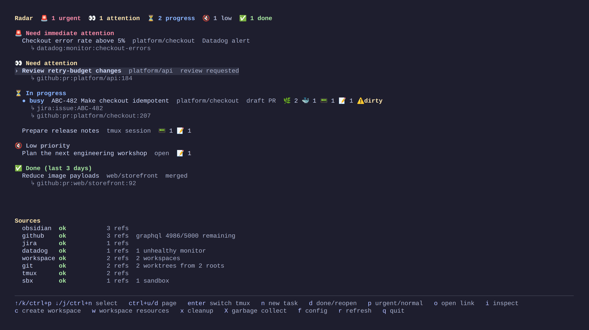

# Radar

**See what needs your attention. Get back to work.**

Radar brings your issues, pull requests, notes and local work into one terminal
dashboard. Open a task to jump into its workspace—with Git worktrees, tmux and
[Pi](https://pi.dev) ready to go.



## Get started

### 1. Install

**Homebrew is recommended on Linux** (amd64/arm64) and is also available on
**macOS** (Apple Silicon, Ventura+). Run without sudo.

**Linux rollout gate:** this source adds Linux support, but the public tap is not
updated just by installing this checkout. Until a new signed release and its
validated Linux-capable tap formula ship, use the [manual Linux path](docs/installation.md#manual-installation).
After publication, with [Homebrew](https://brew.sh) installed:

**Homebrew:**

```sh
brew install ChristianMoesl/tap/radar
radar
```

Homebrew installs Radar, manual pages, fd, tmux and gh. On macOS it also installs
the notification companion. Linux URL actions need `xdg-open` on PATH. Git is
expected on PATH; install [Pi](https://pi.dev) yourself with Node.js 24+ and npm.
`radar` automatically starts setup on first launch or when a required tool is
missing. Setup checks prerequisites and asks before changing configuration or
installing Pi extensions. Update with `brew upgrade radar`, not `radar update`.
[Homebrew setup and updates →](docs/installation.md#homebrew)

**Standalone macOS installer:**

```sh
curl -fsSL https://raw.githubusercontent.com/ChristianMoesl/radar/main/install.sh | bash
```

The installer verifies the release, installs required CLI tools (including Pi,
fd and gh), and starts guided setup. Installation prompts default to Yes but
still ask permission; PATH changes have a separate confirmation. You can decline
any offer; declining a required dependency stops installation.

[Windows/WSL, custom prefixes and manual installation →](docs/installation.md#manual-installation)

### 2. Make it yours

Setup walks you through the tools you need and asks you to:

- Choose where your repositories, workspaces and task notes live. **Obsidian is optional.**
- Connect GitHub, Jira or Datadog—or skip them and start with local work.
- Install the required `pi-radar` extension.
- Review each file and directory change before saving. You can change them later with `radar setup`.

On macOS, follow the optional [notification approval steps](docs/installation.md#macos-notification-setup).
After setup, open a new terminal and run **`radar`** whenever you want your dashboard.
Inside a workspace with the generated tmux config, press **Ctrl+B**, release, then **R**.
Pi prints a short workspace attachment notice with the configured tmux dashboard shortcut.

### 3. Open your first workspace

Press **`c`**, give the workspace a name, and optionally add a repository.
Press **Enter** to create it and open Pi. You can start with just a note and add
repositories later with **`w`**. If Pi needs model access, use **`/login`** in Pi.

Back in the dashboard, use **↑/↓** to choose a task, **Enter** to resume its
workspace, **`i`** to inspect it, or **`o`** to open its issue, PR or note.

Workspaces are disposable: completed ones are automatically cleaned up, and
can lose uncommitted work after eight days. Read the [cleanup policy](docs/workspace-cleanup.md).

## Learn more

| I want to… | Guide |
| --- | --- |
| Finish setup, fix notifications or update Radar | [Installation and updates](docs/installation.md) |
| Learn the dashboard and keyboard shortcuts | [Using Radar](docs/dashboard.md) |
| Create workspaces, add repositories or configure setup commands | [Workspaces](docs/workspaces.md) |
| Connect tools or customize settings | [Configuration](docs/configuration.md) · [Integrations](docs/README.md#integrations) |
| Use the CLI, inspect state or find logs | [Command-line reference](docs/cli.md) |

[All documentation](docs/README.md) · [Contributing](CONTRIBUTING.md) · [MIT License](LICENSE)


### Offline help

Use `man radar` and `man radar-config` for the installed reference. Inside a
Radar workspace, you can also ask Pi “What can Radar do?” or “How do I configure
my workspaces?”. The Radar extension reads documentation embedded in your
installed CLI. See [manual discovery](docs/installation.md#manual-pages) and
[Pi documentation access](docs/integrations/pi.md#ask-pi-about-radar).

Native SBX provisioning is available on macOS and Linux with SBX 0.48.x
(KVM required on Linux). Native SBX inside WSL remains best-effort and requires
the tested daemon/CLI cache policy. See [SBX setup and qualification](docs/integrations/sbx.md#native-linux-inside-wsl2)
before enabling it for Windows-backed canonical notes. Existing workspaces attach
SBX explicitly through normal preview/reconcile, never by changing defaults alone.
